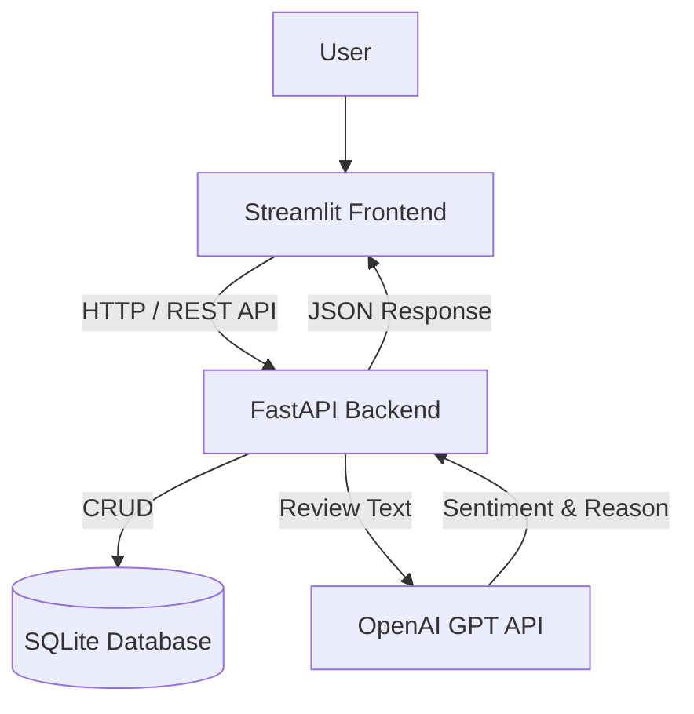
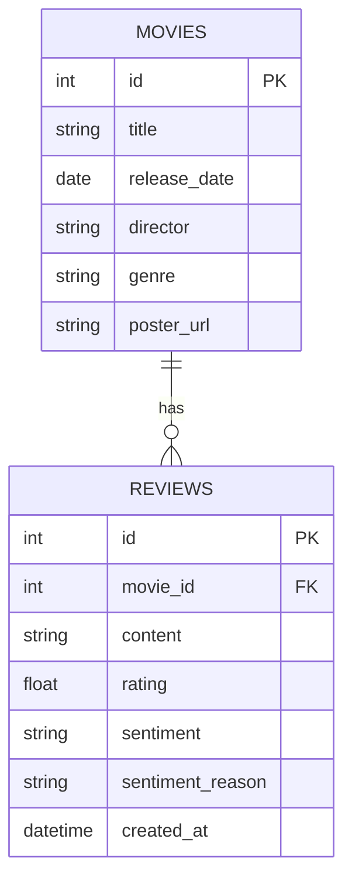

# Movie Sentiment

**GPT API 기반 영화 리뷰 감성 분석 웹 서비스**

코드잇 AI 엔지니어 부트캠프 미션 18에서 개발한 영화 리뷰 웹 애플리케이션입니다.

Streamlit과 FastAPI를 활용하여 영화 정보와 사용자 리뷰를 관리하고, OpenAI GPT API를 통해 리뷰의 감성을 긍정·부정·중립으로 분석합니다.

## 1. 주요 기능

### 영화 관리

- 영화 등록: 제목, 개봉일, 감독, 장르, 포스터 URL
- 전체 영화 목록 및 특정 영화 조회
- 영화 삭제
- 영화 포스터 및 기본 정보 표시

### 리뷰 및 감성 분석

- 영화별 리뷰 작성 및 평점 등록
- GPT API를 활용한 긍정·부정·중립 감성 분석
- 감성 분석 근거 제공
- 영화별 리뷰 목록 조회
- 영화별 평균 평점 및 리뷰 개수 표시

## 2. 기술 스택

| 구분 | 기술 |
|---|---|
| Language | Python 3.12 |
| Frontend | Streamlit |
| Backend | FastAPI |
| Database | SQLite |
| ORM | SQLAlchemy |
| Data Validation | Pydantic |
| AI | OpenAI GPT API (gpt-4.1-mini) |
| API Documentation | Swagger UI |
| Version Control | Git, GitHub |

## 3. 시스템 아키텍처



### 서비스 동작 과정

1. 사용자가 Streamlit에서 영화 정보를 조회하거나 리뷰를 작성합니다.
2. Streamlit이 FastAPI 백엔드로 HTTP 요청을 전송합니다.
3. FastAPI는 영화 및 리뷰 데이터를 SQLite에서 조회하거나 저장합니다.
4. 리뷰 등록 시 OpenAI GPT API를 호출하여 감성을 분석합니다.
5. 분석 결과와 근거를 SQLite에 저장합니다.
6. Streamlit에서 리뷰, 평점, 감성 분석 결과를 표시합니다.

모든 데이터는 FastAPI 백엔드에서 관리하며, Streamlit에서는 별도의 데이터 저장 기능을 사용하지 않습니다.

## 4. 프로젝트 구조

```text
movie-sentiment/
├── back/
│   ├── database.py
│   ├── main.py
│   ├── models.py
│   ├── schemas.py
│   ├── sentiment.py
│   └── requirements.txt
│
├── front/
│   ├── app.py
│   └── requirements.txt
│
├── .env.example
├── .gitignore
└── README.md
```

### 주요 파일 설명

| 파일 | 역할 |
|---|---|
| `back/main.py` | FastAPI 엔드포인트 및 서비스 로직 |
| `back/database.py` | SQLite 연결 및 SQLAlchemy 세션 관리 |
| `back/models.py` | 영화 및 리뷰 ORM 모델 |
| `back/schemas.py` | API 요청 및 응답 데이터 검증 |
| `back/sentiment.py` | OpenAI GPT API 감성 분석 |
| `front/app.py` | Streamlit 사용자 인터페이스 |

## 5. 설치 및 실행 방법

### 5.1 저장소 복제

```bash
git clone https://github.com/diokim17/movie-sentiment.git
cd movie-sentiment
```

### 5.2 Conda 가상환경 생성

Python 3.12 환경을 생성합니다.

```bash
conda create -n mission18 python=3.12 -y
conda activate mission18
```

### 5.3 패키지 설치

프론트엔드와 백엔드에 필요한 패키지를 설치합니다.

```bash
python -m pip install -r back/requirements.txt -r front/requirements.txt
```

### 5.4 환경변수 설정

프로젝트 루트의 `.env.example` 파일을 복사하여 `.env`를 생성합니다.

```bash
cp .env.example .env
```

`.env` 파일에 본인의 OpenAI API 키를 입력합니다.

```dotenv
# OpenAI API Key
OPENAI_API_KEY=your_openai_api_key_here

# OpenAI Model
OPENAI_MODEL=gpt-4.1-mini
```

API 키 발급: https://platform.openai.com/api-keys

> OpenAI API 사용에는 별도 비용이 발생할 수 있습니다. 실제 API 키가 포함된 `.env` 파일은 Git에 업로드하지 않습니다.

### 5.5 FastAPI 백엔드 실행

프로젝트 루트에서 다음 명령어를 실행합니다.

```bash
python -m uvicorn back.main:app --reload
```

실행 후 다음 주소에서 API를 확인할 수 있습니다.

- API 서버: http://127.0.0.1:8000
- Swagger UI: http://127.0.0.1:8000/docs

### 5.6 Streamlit 프론트엔드 실행

FastAPI 서버를 실행한 상태에서 새로운 터미널을 열어 다음 명령어를 실행합니다.

```bash
conda activate mission18
python -m streamlit run front/app.py
```

웹 브라우저에서 다음 주소로 접속합니다.

http://localhost:8501

최초 실행 시 SQLite 데이터베이스와 테이블이 자동 생성됩니다.

데이터베이스 파일은 GitHub에 포함하지 않으므로 초기 상태에서는 영화와 리뷰를 직접 등록해야 합니다.

## 6. API 명세

| Method | Endpoint | 기능 |
|---|---|---|
| GET | `/movies` | 전체 영화 조회 |
| GET | `/movies/{movie_id}` | 특정 영화 조회 |
| POST | `/movies` | 영화 등록 |
| DELETE | `/movies/{movie_id}` | 영화 삭제 |
| GET | `/movies/{movie_id}/reviews` | 영화별 리뷰 조회 |
| POST | `/movies/{movie_id}/reviews` | 리뷰 등록 및 감성 분석 |

### 영화 등록 요청 예시

**POST `/movies`**

```json
{
  "title": "기생충",
  "release_date": "2019-05-30",
  "director": "봉준호",
  "genre": "드라마, 스릴러",
  "poster_url": "https://image.tving.com/ntgs/contents/CTC/caim/CAIM2100/ko/20231211/0020/M000244233.jpeg/dims/resize/480"
}
```

### 리뷰 등록 요청 예시

**POST `/movies/{movie_id}/reviews`**

```json
{
  "content": "배우들의 연기가 훌륭하고 스토리가 정말 재미있었어요.",
  "rating": 5.0
}
```

### 리뷰 등록 응답 예시

```json
{
  "content": "배우들의 연기가 훌륭하고 스토리가 정말 재미있었어요.",
  "rating": 5.0,
  "id": 1,
  "movie_id": 1,
  "sentiment": "positive",
  "sentiment_reason": "배우들의 연기와 스토리에 대한 긍정적인 평가입니다.",
  "created_at": "2026-11-18T06:39:34.974107"
}
```

응답의 ID, 분석 근거, 작성 시각은 실제 실행 결과에 따라 달라집니다.

상세한 요청 및 응답 스키마는 FastAPI Swagger UI에서 확인할 수 있습니다.

## 7. 데이터베이스 설계

영화와 리뷰는 **1:N 관계**로 구성됩니다.



### Movies 테이블

| 컬럼 | 설명 |
|---|---|
| id | 영화 고유 ID (PK) |
| title | 영화 제목 |
| release_date | 개봉일 |
| director | 감독 |
| genre | 장르 |
| poster_url | 포스터 이미지 URL |

### Reviews 테이블

| 컬럼 | 설명 |
|---|---|
| id | 리뷰 고유 ID (PK) |
| movie_id | 영화 ID (FK) |
| content | 리뷰 내용 |
| rating | 사용자 평점 (0~5) |
| sentiment | 감성 분석 결과 |
| sentiment_reason | 감성 분석 근거 |
| created_at | 리뷰 작성 시각 |

영화 삭제 시 해당 영화에 연결된 리뷰도 함께 삭제되도록 설정했습니다.

평균 평점은 저장된 리뷰의 평점을 기반으로 Streamlit에서 계산합니다.

## 8. GPT API 감성 분석

별도의 감성 분석 모델을 학습하거나 서버에 배포하지 않고, OpenAI GPT API를 활용하여 리뷰 감성을 분석합니다.

### 감성 분류 기준

| 분류 | 의미 |
|---|---|
| `positive` | 긍정적인 평가 |
| `negative` | 부정적인 평가 |
| `neutral` | 중립적이거나 감성이 명확하지 않은 평가 |

### 감성 분석 처리 과정

1. 사용자가 리뷰 내용과 평점을 입력합니다.
2. FastAPI가 리뷰 내용을 전달받습니다.
3. OpenAI GPT API에 감성 분석을 요청합니다.
4. GPT가 감성 분류와 한국어 분석 근거를 반환합니다.
5. Pydantic을 통해 응답 구조를 검증합니다.
6. 분석 결과를 리뷰와 함께 SQLite에 저장합니다.

감성 분석 결과는 다음과 같은 구조를 사용합니다.

```json
{
  "sentiment": "positive",
  "reason": "영화의 연출과 배우들의 연기에 대한 긍정적인 평가가 나타납니다."
}
```

OpenAI API의 Structured Outputs 기능을 활용하여 감성 분석 결과가 정의된 데이터 구조에 맞게 반환되도록 구현했습니다.

## 9. 기능 검증 결과

로컬 개발 환경에서 영화 관리, 리뷰 관리, GPT 감성 분석 및 프론트엔드 연동을 검증했습니다.

### API 검증

| 테스트 | 예상 상태 코드 | 결과 |
|---|---|---|
| 영화 등록 | 201 Created | 성공 |
| 전체 영화 조회 | 200 OK | 성공 |
| 특정 영화 조회 | 200 OK | 성공 |
| 영화 삭제 | 204 No Content | 성공 |
| 삭제된 영화 조회 | 404 Not Found | 성공 |
| 리뷰 등록 및 감성 분석 | 201 Created | 성공 |
| 영화별 리뷰 조회 | 200 OK | 성공 |

### 테스트 데이터

| 영화 | 리뷰 수 |
|---|---:|
| 기생충 | 10개 |
| 오디세이 | 10개 |
| 노트북 | 10개 |
| **합계** | **30개** |

기능 검증을 위해 작성한 가상 리뷰 데이터를 사용했습니다.

긍정·부정·중립 감성 분석과 영화별 평균 평점 계산 기능을 구현했으며, 긍정 및 부정 분석 결과를 실제 화면에서 확인했습니다.

## 10. 개발 및 실행 환경

- **OS:** macOS
- **Python:** 3.12
- **Environment:** Conda
- **IDE:** Visual Studio Code
- **Frontend:** Streamlit
- **Backend:** FastAPI
- **Database:** SQLite

---

**Codeit AI Engineer Bootcamp — Mission 18**
